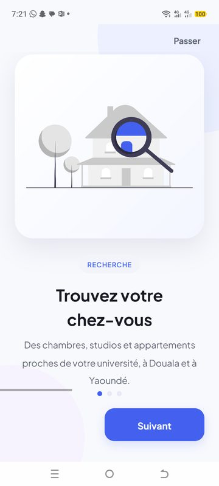
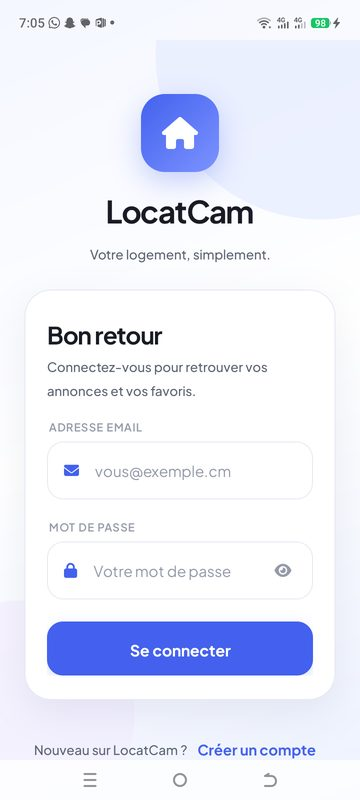
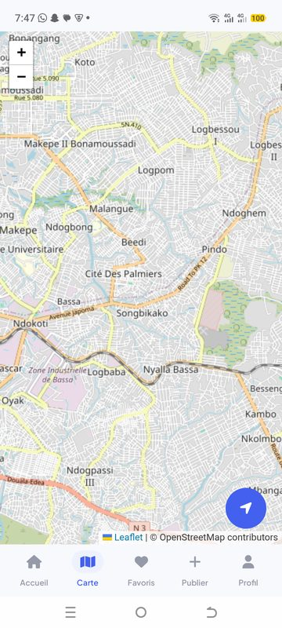
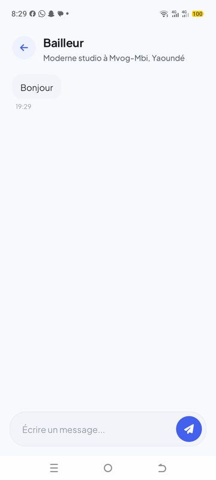
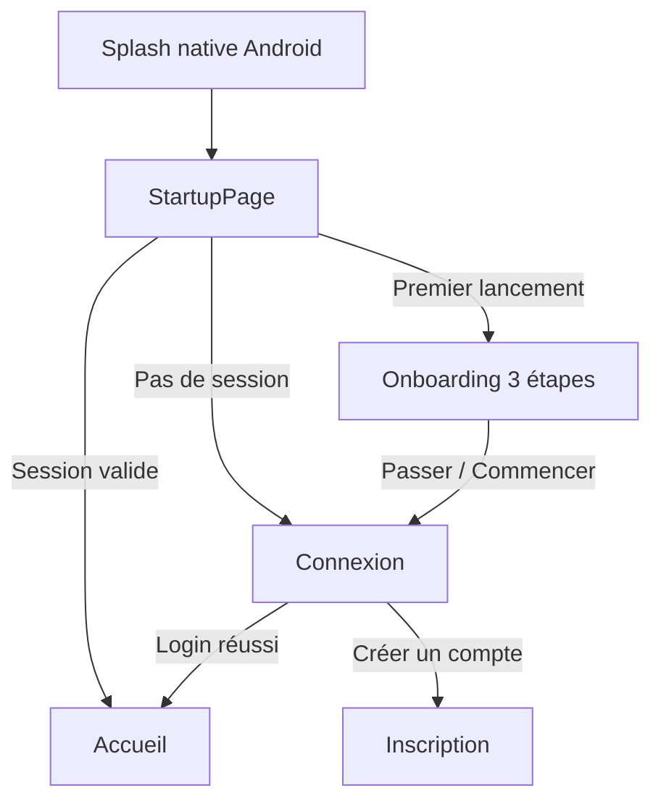

# LocatCam Mobile

> **Trouvez votre logement étudiant au Cameroun, simplement.**
> Application mobile Android développée avec **.NET MAUI**, connectée à l'API LocatCam
> (annonces immobilières, favoris, carte interactive et messagerie).

[](https://dotnet.microsoft.com/)
[](https://learn.microsoft.com/dotnet/maui/)
[](https://developer.android.com/)
[](https://www.sqlite.org/)
[](https://github.com/reactiveui/refit)
[]()

---

## Sommaire

- [Aperçu](#aperçu)
- [Fonctionnalités](#fonctionnalités)
- [Stack technique](#stack-technique)
- [Architecture](#architecture)
- [Structure du projet](#structure-du-projet)
- [Prérequis](#prérequis)
- [Installation](#installation)
- [Configuration](#configuration)
- [Comptes de démonstration](#comptes-de-démonstration)
- [Authentification et démarrage](#authentification-et-démarrage)
- [Design system](#design-system)
- [Mode hors-ligne et gestion des erreurs](#mode-hors-ligne-et-gestion-des-erreurs)
- [API consommée](#api-consommée)
- [Tests et validation](#tests-et-validation)
- [Sécurité et bonnes pratiques](#sécurité-et-bonnes-pratiques)
- [Limitations connues](#limitations-connues)
- [Dépannage](#dépannage)
- [Workflow Git](#workflow-git)
- [Licence](#licence)

---

## Aperçu

LocatCam aide les étudiants à trouver un logement à **Douala** et **Yaoundé** :
recherche par ville ou quartier, filtres par type de bien et budget, consultation
détaillée des annonces, favoris disponibles hors-ligne, carte interactive et
messagerie directe avec les bailleurs.

<table>
  <tr>
    <td align="center"><br/><sub>Onboarding</sub></td>
    <td align="center"><br/><sub>Connexion</sub></td>
    <td align="center"><br/><sub>Accueil</sub></td>
  </tr>
  <tr>
    <td align="center"><br/><sub>Détail d'une annonce</sub></td>
    <td align="center"><br/><sub>Carte interactive</sub></td>
    <td align="center"><br/><sub>Messagerie</sub></td>
  </tr>
</table>

---

## Fonctionnalités

### Expérience utilisateur
- **Onboarding en 3 étapes** (recherche, filtres, contact), passable, illustré avec des
  visuels [unDraw](https://undraw.co/illustrations), et accessible à tout moment depuis
  **Profil → Revoir l'introduction**.
- **Démarrage maîtrisé** : splash native → page de démarrage → onboarding, connexion ou
  accueil, sans flash d'écran intermédiaire.
- **Design system doux et moderne** : bleu LocatCam `#1565C0`, surfaces claires, cartes arrondies,
  ombres légères, typographie Plus Jakarta Sans.
- **Mode sombre** automatique (thème système) ou manuel depuis le profil.
- **Interface responsive** et zones tactiles conformes aux recommandations d'accessibilité.

### Annonces
- Liste paginée des annonces disponibles avec **photos, prix, localisation et badge vérifié**.
- **Recherche** par ville ou quartier (avec second essai automatique sur le quartier).
- **Filtres par catégorie** : tous, appartement, maison, studio, meublé.
- **Détail complet** : grande photo, description, prix, caractéristiques, bailleur,
  bouton d'appel et bouton « Contacter le bailleur ».
- **Favoris** synchronisés avec l'API et mis en cache localement pour consultation hors-ligne.
- **Carte interactive** Leaflet + OpenStreetMap avec marqueurs et fiche d'annonce.

### Compte et échanges
- **Authentification JWT** avec access token et refresh token stockés dans `SecureStorage`.
- **Inscription** étudiant ou bailleur.
- **Messagerie in-app** : liste des conversations, historique, envoi de messages et
  compteur de messages non lus.
- **Profil** : informations du compte, thème, réintroduction de l'onboarding, déconnexion.
- **Publication d'annonces** pour les comptes bailleurs (formulaire connecté à l'API).

### Robustesse
- Détection de la connectivité et **bandeau hors-ligne**.
- **Skeletons** de chargement, états vides illustrés et pull-to-refresh.
- **Gestion d'erreurs explicite** : identifiants invalides, serveur indisponible ou
  absence de connexion Internet sont désormais distingués dans l'UI.
- Restauration de session et du Bearer token après redémarrage de l'application.

---

## Stack technique

| Domaine | Technologie |
|---|---|
| Framework | .NET 10 / .NET MAUI |
| Plateforme cible | Android 21+ (`net10.0-android`) |
| Langage | C# |
| Architecture | MVVM + injection de dépendances |
| Client HTTP | Refit 7.1 + `HttpClient` + `DelegatingHandler` |
| Résilience | Polly 8.4 |
| Stockage local | SQLite (`sqlite-net-pcl`) |
| Stockage sécurisé | `SecureStorage` (tokens JWT) |
| UI | XAML, styles et ressources partagés, Font Awesome |
| Cartographie | WebView + Leaflet.js + OpenStreetMap |
| Médiathèque | CommunityToolkit.Maui |
| Images | unDraw (onboarding), Unsplash (données seed) |

---

## Architecture

L'application suit une architecture **MVVM** avec séparation claire des responsabilités :

```text
View (XAML)  ──binding──▶  ViewModel  ──▶  Service métier  ──▶  IApiClient (Refit)
                               │                    │
                               │                    ├──▶  API LocatCam (HTTP/JSON)
                               │                    └──▶  SQLite (cache hors-ligne)
                               └──▶  NavigationShell / AnnonceSelection / ConversationSelection
```

### Flux de démarrage



- `StartupPage` est le premier `ShellContent` : aucune page ne s'affiche avant la décision.
- La session est vérifiée via un drapeau `Preferences` puis le token `SecureStorage`.
- Le token est réinjecté dans `TokenHandler` pour les appels authentifiés suivants.

### Navigation

- Un `Shell` unique contient les pages racines (accueil, carte, favoris, messagerie,
  publier, profil, connexion, inscription, détail).
- `NavigationShell` centralise la sélection des pages, fiabilise les routes et mémorise
  la page d'origine pour les boutons retour.
- Les pages métier utilisent une barre de navigation basse personnalisée.

---

## Structure du projet

```text
LocatCam_mobile/
├── App.xaml / App.xaml.cs          # Racine de l'application, création de la fenêtre
├── AppShell.xaml / .cs             # Shell, routes et pages racines
├── MauiProgram.cs                  # DI, polices, handlers Android
├── Controls/                       # Composants réutilisables (carte, nav, skeletons…)
├── Converters/                     # Convertisseurs XAML (booléens, prix, dates…)
├── Models/                         # DTOs de l'API
├── Services/
│   ├── ApiClient.cs                # Fabrique Refit + URL de base
│   ├── AuthService.cs              # Login, logout, session, refresh
│   ├── TokenHandler.cs             # Injection du Bearer token
│   ├── AnnonceService.cs           # Annonces
│   ├── FavoriService.cs            # Favoris + cache SQLite
│   ├── MessageService.cs           # Conversations et messages
│   ├── LocalDbService.cs           # Base SQLite locale
│   ├── NavigationShell.cs          # Navigation déterministe
│   └── Interfaces/                 # Contrats des services
├── ViewModels/                     # Logique de présentation MVVM
├── Views/                          # Pages XAML (accueil, détail, carte, profil…)
├── Resources/
│   ├── Fonts/                      # Plus Jakarta Sans + Font Awesome
│   ├── Images/                     # Illustrations d'onboarding
│   ├── Styles/                     # Couleurs et styles du design system
│   └── Splash/                     # Écran de démarrage
├── Platforms/Android/              # Manifest, MainActivity, ressources natives
└── docs/screenshots/               # Captures utilisées dans ce README
```

---

## Prérequis

- **.NET SDK 10.0** (testé avec `10.0.401`)
- Workload **`maui-android`**
- **Android SDK** (API 21 minimum, API 35/36 recommandée)
- **JDK 17+**
- Un appareil Android en mode développeur ou un émulateur

```bash
dotnet workload install maui-android
```

Vérification :

```bash
dotnet --info
dotnet workload list
```

---

## Installation

```bash
# 1. Cloner le dépôt
git clone https://github.com/TSEFACKDEV/LocatCam_mobile.git
cd LocatCam_mobile

# 2. Restaurer les dépendances
dotnet restore

# 3. Compiler pour Android
dotnet build -f net10.0-android -c Debug

# 4. Déployer sur l'appareil connecté
dotnet build -t:Run -f net10.0-android
```

Ou installer l'APK généré :

```bash
adb install -r bin/Debug/net10.0-android/com.companyname.locatcam_mobile-Signed.apk
```

> **Astuce build** : pour un APK autonome (sans fast deployment), utiliser
> `dotnet build -f net10.0-android -c Debug -p:EmbedAssembliesIntoApk=true`.

### Build Release

```bash
dotnet publish -f net10.0-android -c Release
```

---

## Configuration

### URL de l'API

L'URL de base est définie dans `Services/ApiClient.cs` :

```csharp
private const string BaseUrl = "http://169.58.69.36:5206/";
```

Le backend est disponible dans le dépôt
[LocatCam_server](https://github.com/TSEFACKDEV/LocatCam_server).

### Trafic HTTP

L'API du VPS est actuellement servie en **HTTP**. Android 9+ bloquant le trafic non
chiffré par défaut, le manifest autorise explicitement le cleartext :

```xml
<application android:usesCleartextTraffic="true" ... />
```

> En production, privilégier **HTTPS** et retirer cette autorisation.

### Test en local

Pour tester sur un appareil physique avec une API locale :

```bash
# Rediriger le port de l'appareil vers la machine hôte
adb reverse tcp:5206 tcp:5206
```

Puis pointer temporairement `BaseUrl` vers `http://127.0.0.1:5206/` et reconstruire.

---

## Comptes de démonstration

Les données de démonstration sont créées automatiquement en environnement
**Development** par `LocatCam.Infrastructure/Seed/DataSeeder.cs` :

- **15 utilisateurs** (3 admins, 6 bailleurs, 6 étudiants)
- **40 annonces**, **24 favoris**, **13 messages**

| Rôle | Email | Mot de passe |
|---|---|---|
| Étudiant | `etudiant1@locatcam.cm` … `etudiant6@locatcam.cm` | `Etudiant@123` |
| Bailleur | `bailleur1@locatcam.cm` … `bailleur6@locatcam.cm` | `Bailleur@123` |
| Admin | `admin1@locatcam.cm` … `admin3@locatcam.cm` | `Admin@123` |

Exemple :

```text
Email        : etudiant1@locatcam.cm
Mot de passe : Etudiant@123
```

> ⚠️ Ces comptes sont réservés à la démonstration et aux tests. Ils ne doivent jamais
> être utilisés en production.

---

## Authentification et démarrage

1. L'utilisateur saisit ses identifiants sur `LoginPage`.
2. `AuthService` appelle `POST /api/auth/login`.
3. Les tokens sont stockés dans `SecureStorage` et l'utilisateur dans les préférences
   sécurisées de session.
4. `TokenHandler` injecte automatiquement `Authorization: Bearer <token>` sur les
   requêtes authentifiées.
5. Au redémarrage, `StartupPage` restaure le token et ouvre directement l'accueil si la
   session est toujours valide.
6. En cas de `401`, le `TokenHandler` tente un refresh ; si le refresh échoue, la
   session est considérée comme expirée.

---

## Design system

### Palette

| Rôle | Couleur clair | Couleur sombre |
|---|---|---|
| Accent | `#1565C0` | `#64B5F6` |
| Accent clair | `#1E88E5` | — |
| Fond | `#F8F9FD` | `#0E1017` |
| Surface carte | `#FFFFFF` | `#181B23` |
| Surface douce | `#F2F4FA` | `#232733` |
| Encre principale | `#191B24` | `#F3F4F8` |
| Encre secondaire | `#5D6474` | `#A8AEBD` |
| Bordure | `#E7EAF3` | `#2B3040` |
| Succès | `#2F9E6E` | `#6FD3A5` |
| Erreur | `#D95858` | `#F08A8A` |

### Typographie

- **Plus Jakarta Sans** en graisses statiques : Regular, Medium, SemiBold, Bold.
- Échelle : Display 30 px, H1 24 px, H2 19 px, Body 15 px, Caption 13 px, Micro 11 px.
- Interlignage aéré et espacement négatif léger sur les titres.

### Composants

- Cartes arrondies (rayon 20–26 px) avec ombre douce.
- Boutons pilule (rayon 16 px, hauteur 54 px) et puces de filtre.
- Champs de saisie encadrés, sans soulignement Material.
- Pastilles d'icônes, badges « Vérifié », skeletons et états vides illustrés.
- Illustrations unDraw pour l'onboarding.

---

## Mode hors-ligne et gestion des erreurs

- `ConnectivityService` surveille l'état du réseau et affiche un bandeau hors-ligne.
- Les favoris et les dernières recherches sont mis en cache dans SQLite.
- Les services retournent des listes vides en cas d'échec réseau, sans crasher l'UI.
- Les erreurs de connexion sont distinguées :
  - `401` → identifiants incorrects ;
  - `429` → trop de tentatives ;
  - autre statut → serveur indisponible ;
  - exception réseau → impossible de joindre le serveur.

---

## API consommée

| Méthode | Endpoint | Usage mobile |
|---|---|---|
| `POST` | `/api/auth/login` | Connexion |
| `POST` | `/api/auth/register` | Inscription |
| `POST` | `/api/auth/refresh` | Renouvellement du token |
| `GET` | `/api/auth/me` | Profil connecté |
| `GET` | `/api/annonces` | Liste paginée + filtres |
| `GET` | `/api/annonces/{id}` | Détail d'une annonce |
| `GET` | `/api/annonces/map` | Annonces pour la carte |
| `POST` | `/api/annonces` | Publication (bailleur) |
| `PUT` | `/api/annonces/{id}` | Modification (propriétaire) |
| `DELETE` | `/api/annonces/{id}` | Suppression (propriétaire) |
| `GET` | `/api/favoris` | Liste des favoris |
| `POST` | `/api/favoris/{annonceId}` | Ajouter un favori |
| `DELETE` | `/api/favoris/{annonceId}` | Retirer un favori |
| `GET` | `/api/messages/conversations` | Messages / conversations |
| `GET` | `/api/messages/conversation/{userId}` | Historique d'une conversation |
| `POST` | `/api/messages` | Envoyer un message |
| `PUT` | `/api/messages/{id}/lu` | Marquer comme lu |
| `POST` | `/api/signalements` | Signaler une annonce |

> Certains endpoints renvoient des structures imbriquées (favoris avec `annonce`,
> messages à plat). Le mobile adapte et normalise ces réponses côté services.

---

## Tests et validation

Validation effectuée sur un appareil Android physique (TECNO KM5, Android 15) :

- ✅ Démarrage : splash → onboarding (premier lancement), puis connexion.
- ✅ Connexion avec les comptes seed (étudiant, bailleur, admin).
- ✅ Navigation basse : accueil, carte, favoris, publier, profil.
- ✅ Recherche « Bastos » → résultats filtrés.
- ✅ Filtre « Appartement » → annonces correspondantes.
- ✅ Ouverture du détail par tap sur la photo ou le texte d'une carte.
- ✅ Retour depuis le détail vers la page d'origine.
- ✅ Favoris chargés avec titres, prix et photos.
- ✅ Messagerie : ouverture d'une conversation et envoi d'un message.
- ✅ Build Android : **0 erreur**.

### Vérifier le build

```bash
dotnet build -f net10.0-android -c Debug
```

---

## Sécurité et bonnes pratiques

- **Ne jamais committer** de secrets (JWT, Cloudinary, mots de passe de base de données).
- Les tokens sont stockés dans `SecureStorage`, jamais en clair dans des préférences.
- Les comptes de démonstration doivent être désactivés ou supprimés avant mise en production.
- Le trafic HTTP en clair est toléré uniquement pour le développement : passer à **HTTPS**
  avant toute distribution publique.
- Renouveler les clés JWT et Cloudinary exposées dans l'historique du dépôt serveur.
- Limiter les permissions Android au strict nécessaire.
- Ajouter une politique de confidentialité et une fiche Play Store avant publication.

---

## Limitations connues

- L'API est servie en **HTTP** (pas de TLS) sur le VPS de démonstration.
- L'upload de photos est désactivé tant que la signature Cloudinary côté serveur n'est
  pas corrigée.
- Le endpoint de refresh token peut échouer (`400/503`) selon l'état du serveur ;
  l'application redirige alors vers la connexion.
- Les images des annonces proviennent d'Unsplash et peuvent être lentes ou indisponibles
  selon la connexion.
- L'application est actuellement ciblée **Android** (le projet multi-plateforme reste
  préparé pour iOS/MacCatalyst).

---

## Dépannage

### « Email ou mot de passe incorrect » alors que les identifiants sont bons

Vérifier d'abord que l'API et sa base sont opérationnels :

```bash
# Sur le VPS
docker ps
docker logs --tail 50 locatcam-api
```

Le conteneur PostgreSQL `locatcam-db` doit être **Up (healthy)**. S'il est arrêté :

```bash
docker start locatcam-db
```

### L'application ne joint pas l'API

- Vérifier l'URL dans `Services/ApiClient.cs`.
- Vérifier `android:usesCleartextTraffic="true"` dans le manifest.
- Tester l'API depuis la machine :

```bash
curl -X POST http://169.58.69.36:5206/api/auth/login \
  -H "Content-Type: application/json" \
  -d '{"email":"etudiant1@locatcam.cm","motDePasse":"Etudiant@123"}'
```

### L'onboarding ne s'affiche plus

L'application le considère comme déjà vu. Deux solutions :

1. **Profil → Revoir l'introduction** ;
2. Effacer les données de l'application :

```bash
adb shell pm clear com.companyname.locatcam_mobile
```

### Erreur de build MAUI

```bash
dotnet workload update
dotnet workload install maui-android
dotnet clean
dotnet restore
```

---

## Workflow Git

- Branches par phase : `phase/a-setup`, `phase/b-auth`, …, `fix/navigation-crash-design-v2`.
- Commits conventionnels : `feat`, `fix`, `style`, `docs`, `test`, `chore`.
- Merge dans `main` après validation et build vert.

Exemple :

```bash
git checkout -b fix/ma-correction
git add .
git commit -m "fix(mobile): corriger la navigation basse"
git push origin fix/ma-correction
```

---

## Licence

© 2026 **LocatCam** — Tous droits réservés.

Ce dépôt est un projet privé. Toute reproduction, distribution ou utilisation
commerciale sans autorisation écrite est interdite.

Pour toute question : ouvrir une issue sur
[GitHub](https://github.com/TSEFACKDEV/LocatCam_mobile).
